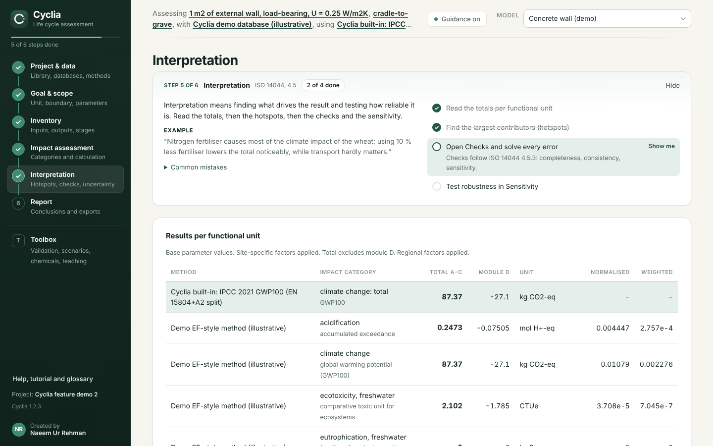
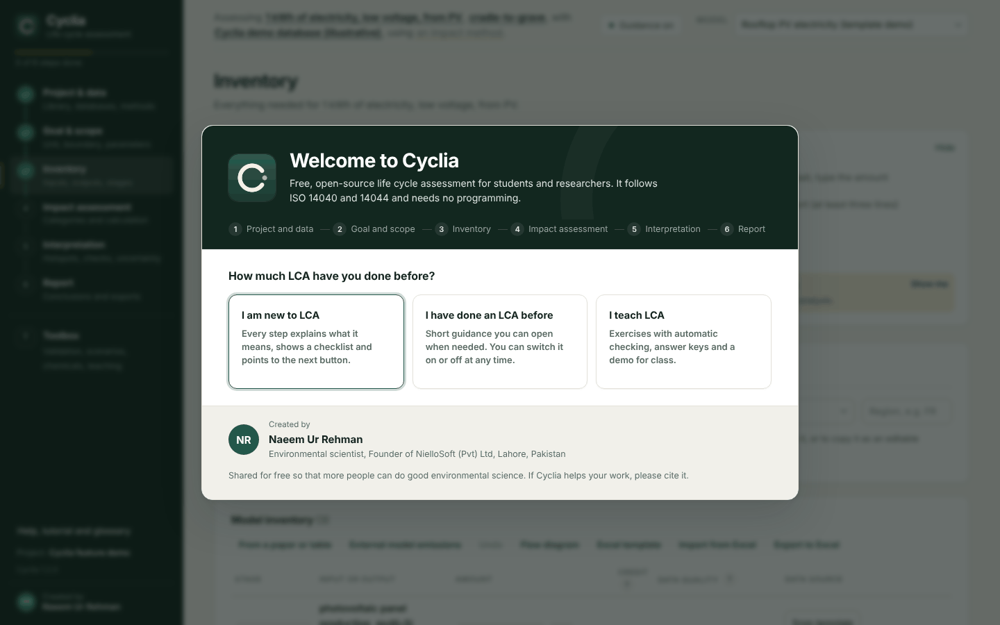
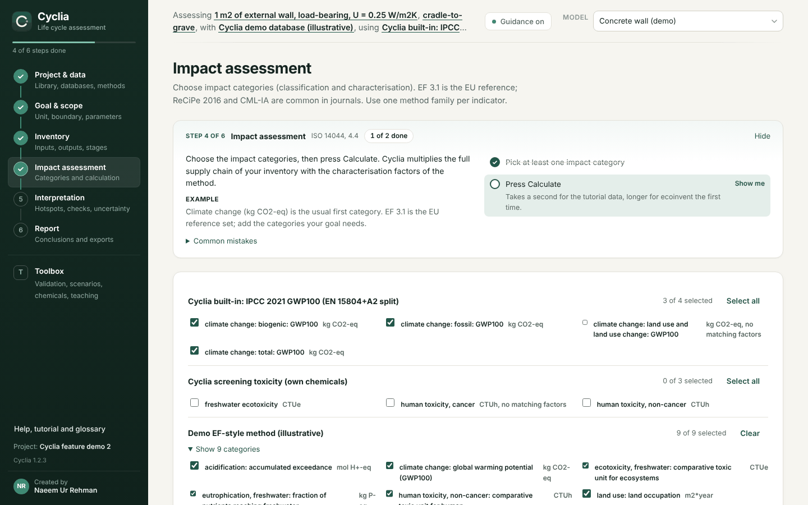
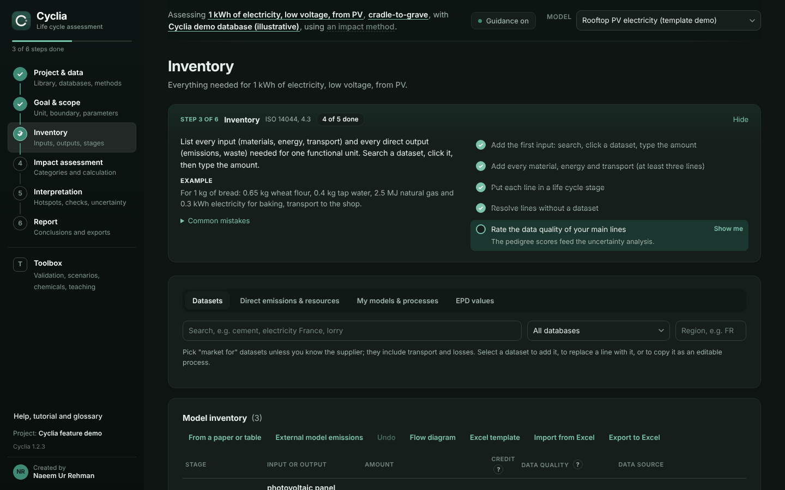

<p align="center">
  
</p>

<h1 align="center">Cyclia: free, open-source LCA software</h1>

<p align="center">
  <b>Life cycle assessment for students, researchers and consultants, without programming.</b><br>
  ISO 14040/14044 workflow · ecoinvent with your own licence · EPD per EN 15804+A2 · ISO 14067 carbon footprint ·
  Monte Carlo uncertainty · life cycle costing
</p>

<p align="center">
  <a href="https://github.com/pdnaeem/cyclia/releases/latest"></a>
  <a href="LICENSE"></a>
  
  <a href="docs/VALIDATION_ECOINVENT.md"></a>
  <a href="https://doi.org/10.5281/zenodo.23853747"></a>
</p>

<p align="center">
  <a href="https://github.com/pdnaeem/cyclia/releases/latest"><b>Download</b></a>
  &nbsp;·&nbsp; <a href="docs/USER_GUIDE.md">User guide</a>
  &nbsp;·&nbsp; <a href="docs/METHODS.md">Methods</a>
  &nbsp;·&nbsp; <a href="docs/VALIDATION_ECOINVENT.md">Validation</a>
  &nbsp;·&nbsp; <a href="docs/FEATURE_STATUS.md">Feature status</a>
  &nbsp;·&nbsp; <a href="#cite-cyclia">Cite</a>
</p>



## Contents

- [What is Cyclia?](#what-is-cyclia)
- [Validated results](#validated-results)
- [Features](#features)
- [Download and install](#download-and-install)
- [Frequently asked questions](#frequently-asked-questions)
- [Cite Cyclia](#cite-cyclia)
- [Documentation](#documentation)
- [Contributing and support](#contributing-and-support)

## What is Cyclia?

Cyclia is a free desktop application for **life cycle assessment (LCA)**. It calculates the environmental impact
of a product, material, building or service, from raw material extraction to end of life.

Cyclia is made for people who need a credible, publishable LCA and do not program: master's and PhD students,
researchers, lecturers, architects, engineers and small consultancies.

- **Guided study.** Cyclia leads you through an ISO 14040/14044 study: goal and scope, inventory, impact
  assessment, interpretation and reporting. Each step explains what to do and checks your work.
- **Ready reports.** It writes a structured Word report with a methods paragraph you can use in a thesis or a
  journal article.
- **Your own data.** Cyclia ships with no database. Use your **ecoinvent** licence, free databases such as
  USLCI, Agribalyse or ELCD, or enter your own processes, flows and factors. Projects and data stay on your
  computer.

## Validated results

Cyclia checks its own calculations against independent references:

| Check | Result |
|---|---|
| Comparison with ecoinvent's published LCIA results (EF 3.1, cut-off, 100 datasets, 25 categories) | **100 % of 2,500 results within 0.1 %**, median deviation 3.9e-07 % ([report](docs/VALIDATION_ECOINVENT.md)) |
| Validation suite of 35 product systems with exact known answers | Run it in the app (Toolbox > Validation) and attach the report to your study |
| Independent second calculation (rebuilt matrices, different solver) | Built in ([cross validation](docs/CROSS_VALIDATION.md)) |
| Comparison with Brightway (bw2calc) on the same database | All results within 1e-6, largest difference 1.4e-12; runs in the app on any database ([cross validation](docs/CROSS_VALIDATION.md)) |
| Characterisation factors compared with openLCA, Brightway or CSV factor sets | Flow by flow, with the effect of every difference |
| Automated tests of the calculation engine | 227 tests, run on Windows, macOS and Linux before every release |

The status of every feature, including what is not validated yet, is listed in
[docs/FEATURE_STATUS.md](docs/FEATURE_STATUS.md).

## Features

**Guided LCA workflow**
- Six steps in ISO 14044 order, each with an explanation, an example, common mistakes and a checklist
- Three ways to start: a guided first study, a complete demo, or your own project
- Glossary, tutorial and feature tour in plain language

**Databases and impact assessment methods**
- ecoinvent download with your own licence, or import of a release you already have
- openLCA JSON-LD, SimaPro CSV, ILCD (ÖKOBAUDAT, EF datasets), ecoSpold1 and ecoSpold2
- EF 3.1 (Environmental Footprint) with JRC normalisation and weighting, ReCiPe 2016, CML-IA, IPCC 2021 GWP100
  split per EN 15804+A2, or any method from a CSV table
- Staged imports with an integrity report and rollback; process identity and named suppliers kept
- Database explorer with filters, database check, version comparison and model migration
- **Your own data**: describe processes no database has (your factory, farm or new material) with their inputs,
  waste, credits, emissions, uncertainty, data quality and characterisation factors, parameters and formulas,
  co-products with allocation, units of your own, and a supply chain diagram you draw by connecting boxes. Unique identifiers, sources
  and change history for every item, unit checks, a worked example, and a step-by-step guide. A flow without a
  known factor marks the result incomplete; it is never counted as zero

**Modelling**
- Parameters, formulas and scenarios; allocation by mass, economic value, energy or physical relation; system
  expansion and avoided products
- Circular Footprint Formula (EU PEF) for recycled content, recycling and energy recovery
- EN 15804+A2 modules A to D, biogenic carbon, dynamic GWP
- Background scenarios for prospective and consequential LCA (premise and Activity Browser files)
- Inventory from tables in papers and reports (PDF, Word, Excel or pasted text)
- Templates for buildings, packaging, food and energy

**Interpretation**
- Contribution analysis by input, process, elementary flow and life cycle stage; supply chain tree and Sankey
  diagram
- Monte Carlo uncertainty with the pedigree matrix and correlated parameters, Sobol sensitivity indices and a
  convergence check, through every nested model
- Key findings in plain language, burden-shifting alerts, and data quality per result (pedigree indicator and
  PEF DQR, kept apart)
- Water scarcity (AWARE) and land use (LANCA) per process location with imported official factors
- Life cycle costing with discounting and replacements, next to the environmental results
- Material flow analysis with stocks, lifetimes and the Material Circularity Indicator
- Social LCA screening of worker hours and risk hours with PSILCA, SOCA or your own data

**Reports and standards**
- ISO 14044 Word report, executive summary, Excel workbook, figures for journals (300 dpi PNG and SVG)
- EPD per ISO 14025:2026 and EN 15804+A2 with layouts for EPD International, IBU and INIES (labelled as drafts
  until verified), and ILCD+EPD XML for ÖKOBAUDAT and the InData network
- ISO 14067 carbon footprint report, GHG Protocol workbook, PEF most relevant results, critical review checklist
- Export to Brightway and openLCA; Python and R clients; reproducibility bundles with fingerprints

**Teaching**
- Exercises with automatic checking and an answer key

| Guided first start | Impact assessment | Dark mode |
|---|---|---|
|  |  |  |

## Download and install

1. Open the [latest release](https://github.com/pdnaeem/cyclia/releases/latest).
2. Download the installer for your system:
   - Windows: `Cyclia-Setup-x.y.z.exe`
   - macOS on Apple silicon (M1 or later): the `.dmg`
   - Linux: the `.AppImage` or the `.deb`
3. Install and start Cyclia. Choose "Learn with a first study" to try it with the free tutorial database.

Installed copies update themselves when a new release is published.

## Frequently asked questions

**Is Cyclia free?**
Yes. Cyclia is free and open-source software under the MIT licence, for academic and commercial use.

**Do I need an ecoinvent licence?**
Only for ecoinvent data. Cyclia also reads free databases (USLCI, Agribalyse, ELCD and others in openLCA
JSON-LD, ILCD or SimaPro CSV format) and includes a tutorial database for learning.

**Can I enter my own data when no database has my process?**
Yes. In Toolbox > Your own data you describe your own processes, products, emissions and characterisation factors, even with an empty library, and use them like any other dataset. Cyclia checks units, keeps the source and history of every item, and marks a result incomplete when a factor is unknown instead of counting it as zero. A worked example and a step-by-step guide show how. See the [user guide](docs/USER_GUIDE.md#your-own-data-custom-data-entry).

**Do I need to know Python?**
No. Everything works through the interface. Python and R clients are available for scripted work.

**How does Cyclia compare with openLCA, SimaPro or Brightway?**
openLCA and Brightway are open-source; SimaPro and Sphera LCA for Experts are commercial. Cyclia guides users
through a complete ISO 14044 study, explains each result, checks its own calculations and writes ready reports.
It exports models to openLCA and Brightway. A comparison based on each vendor's documentation is in the
[roadmap](docs/ROADMAP.md#3-comparison-with-other-lca-software).

**Which standards does Cyclia follow?**
ISO 14040/14044, ISO 14071:2024 (critical review), ISO/TS 14074:2022, ISO 14067, ISO 14025:2026, EN 15804+A2
and the EU PEF method (EF 3.1). What each one is used for is listed in the [roadmap](docs/ROADMAP.md).

**Can I publish results calculated with Cyclia?**
Yes, with a licensed or published database. Report the Cyclia version, attach the validation report and cite
Cyclia. The tutorial and demo data are illustrative and must not be published.

**Does my data leave my computer?**
No. Projects and databases are stored locally. Cyclia goes online only to download ecoinvent with your login
and to check for updates.

## Cite Cyclia

If Cyclia helps your research, please cite it:

> Rehman, N. U. (2026). *Cyclia: open-source life cycle assessment software for researchers* (version 1.6.1)
> [Computer software]. https://doi.org/10.5281/zenodo.23853747

GitHub's "Cite this repository" button gives APA and BibTeX from [CITATION.cff](CITATION.cff). In the app,
Help > About copies the citation, BibTeX or a sentence for your methods section.

## Documentation

| Document | Content |
|---|---|
| [User guide](docs/USER_GUIDE.md) | Every step and tool of the app |
| [Methods](docs/METHODS.md) | Calculation methods, equations and references |
| [Validation against ecoinvent](docs/VALIDATION_ECOINVENT.md) | Benchmark results per category and dataset group |
| [Cross validation](docs/CROSS_VALIDATION.md) | Independent second calculation and factor matching |
| [Feature status](docs/FEATURE_STATUS.md) | What is validated, implemented, partial or planned |
| [Development plan](docs/DEVELOPMENT_PLAN.md) | Planned work in order of priority, with acceptance criteria |
| [Roadmap](docs/ROADMAP.md) | Standards, features by LCA phase, comparison with other software |
| [Changelog](docs/CHANGELOG.md) | Changes in every release |
| [Examples](docs/examples/README.md) | Templates and example files for imports and profiles |

## Contributing and support

- Questions and ideas: [GitHub Discussions](https://github.com/pdnaeem/cyclia/discussions)
- Bugs and feature requests: [issues](https://github.com/pdnaeem/cyclia/issues/new/choose)
- How to contribute: [CONTRIBUTING.md](CONTRIBUTING.md) · Security: [SECURITY.md](SECURITY.md) ·
  Support options: [SUPPORT.md](SUPPORT.md)
- Private support: support@niellosoft.com

Cyclia is developed without outside funding. You can support its maintenance and validation through
[PayPal](https://paypal.me/pdnaeem) or [Revolut](https://revolut.me/pdnaeem). Starring the repository and
citing Cyclia also help.

### Build from source

```bash
pip install -r engine/requirements.txt
python -m unittest discover -s engine/tests
cd app && npm install && npm start
```

On Windows, `build-windows.bat` runs the tests, builds the engine and creates the installer in `app\dist`. On
macOS and Linux, use `build-mac-linux.sh`.

```
app/            Electron desktop application and interface
engine/         Python calculation engine (local, token-protected API on 127.0.0.1)
engine/tests/   automated tests
docs/           user guide, methods, validation, release notes, screenshots
```

## Author

Created by **Naeem Ur Rehman**, environmental scientist and founder of NielloSoft (Pvt) Ltd.
[LinkedIn](https://www.linkedin.com/in/pdnaeem/) · [GitHub](https://github.com/pdnaeem) ·
[niellosoft.com](https://niellosoft.com)

## Licence

MIT, copyright (c) 2026 Naeem Ur Rehman and the Cyclia contributors. See [LICENSE](LICENSE). ecoinvent and other
databases are not part of Cyclia and keep their own licences. Third-party components are listed in
[THIRD_PARTY.md](THIRD_PARTY.md).
